  

Estudiante de Ingeniería en Informática en DuocUC, apuntando a DevOps y DevSecOps. Trabajo entre la ciberseguridad defensiva, la infraestructura y el desarrollo, con experiencia en operaciones SOC/NOC.

[Portfolio](https://bcameron.dev) · [LinkedIn](https://linkedin.com/in/bernardocameron) · [Correo](mailto:b.cameron.i26@gmail.com)

## En lo que trabajo

| Área | Herramientas |
|---|---|
| Ciberseguridad | Wazuh, AlienVault, FortiGate, Palo Alto, Bitdefender, Kaspersky, Tenable |
| Infraestructura | VMware ESXi, Docker, AWS, Zabbix, Grafana, Ansible, Terraform, Linux |
| Desarrollo | Python, Java (Spring Boot), TypeScript, React, Next.js, Kotlin, MySQL, MongoDB, Supabase |

## Proyectos

| Proyecto | Qué es | Stack |
|---|---|---|
| [bcameron.dev](https://github.com/BernardoCameron/portafolio) | Mi portfolio personal | Next.js, TypeScript, Tailwind |
| [BrewStore](https://github.com/BernardoCameron/brewstore-) | Tienda de cervezas artesanales con login y panel de administración. [Ver en vivo](https://brewstore.bcameron.dev) | Next.js, Supabase, Tailwind |
| [IP Threat Intelligence Enricher](https://github.com/BernardoCameron/ip-checker) | Script que enriquece IPs con distintas fuentes de threat intelligence | Python |
| [Wazuh + Docker Lab](https://github.com/BernardoCameron/wazuh-docker-lab) | Laboratorio de monitoreo con Wazuh y un agente de pruebas, desplegado con Docker Compose | Wazuh, Docker |
| [Wazuh + FortiGate](https://github.com/BernardoCameron/Wazuh-fortigate) | Decoders y reglas para procesar syslogs de FortiGate en Wazuh | Wazuh |
| [SmartLogix](https://github.com/BernardoCameron/SmartLogix) | Plataforma de gestión logística con microservicios | Java, Spring, TypeScript |
